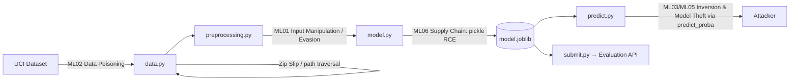

# 🛡️ SMS Spam Classifier — AI Red Teaming Project

A production-ready refactor of a Jupyter notebook built for the **Hack The Box Academy AI Red Teaming** path. It trains a Multinomial Naive Bayes model on the UCI SMS Spam Collection. Along the way it treats the ML pipeline the way a red teamer would: as an attack surface to understand, harden and later attack.

---

## 🎯 AI Red Teaming Objectives

| # | Objective | How this project addresses it |
|---|-----------|-------------------------------|
| 1 | **Understand the target system** | Rebuilds a real text classifier from start to finish (data → features → model → deployment). Each stage is a place where an attacker can step in. |
| 2 | **Map the ML attack surface** | Documents the risks at each stage: data poisoning (ingestion), evasion (preprocessing and features), model theft and inversion (inference API), and supply-chain/RCE (model serialization). |
| 3 | **Establish a trustworthy baseline** | Stratified hold-out evaluation and F1-optimised tuning give a measured baseline. Later adversarial attacks are compared against it. |
| 4 | **Identify evasion vectors** | The preprocessing deletes digits and punctuation and stems words. Obfuscation like `fr33 pr1ze` or Unicode homoglyphs therefore changes what the model sees. This is the starting point for evasion testing. |
| 5 | **Harden the deployment** | Zip Slip protection, HTTP timeouts, SHA-256 model integrity checks, and data/models kept out of git. |

### Threat model (OWASP ML Top 10 / MITRE ATLAS mapping)



| Stage | Threat | ATLAS technique | Mitigation in repo |
|-------|--------|-----------------|--------------------|
| Ingestion | Malicious archive / poisoned data | AML.T0020 Poison Training Data | `_safe_extract`, dedup, label-balance logging |
| Preprocessing | Token obfuscation, homoglyphs, padding with "ham" words | AML.T0015 Evade ML Model | Single shared `preprocess_message` (no train/serve skew). The vectors themselves are documented for testing. |
| Persistence | Pickle deserialization → arbitrary code exec | AML.T0010 ML Supply Chain Compromise | SHA-256 sidecar verified before `joblib.load` |
| Inference | Probability output leaks decision boundary | AML.T0024 Exfiltration via Inference API | Probabilities only shown locally. In production, return labels only. |

---

## 🧪 Hack The Box Methodologies Applied

1. **Recon / enumeration of the dataset.** `head`, `describe`, `info`, checks for nulls and duplicates, and class distribution. This is like enumerating a target before attacking it.
2. **Systematic NLP pipeline.** Lowercasing → regex filtering (keeps `$` and `!` because they carry spam signal) → NLTK tokenization → stop-word removal → Porter stemming.
3. **Feature engineering.** `CountVectorizer` with unigrams and bigrams, `max_df=0.9` to drop near-universal tokens.
4. **Model selection with cross-validation.** `GridSearchCV` over the MultinomialNB smoothing parameter `alpha`, 5-fold, optimised for **F1**. Spam data is imbalanced (~13% spam), so accuracy would be misleading.
5. **Adversarial sanity checks.** The model is tested on hand-written phishing and lure messages (fake gift cards, account-compromise alerts, premium-rate SMS) next to benign ones.
6. **Serialization and submission.** The model is exported with `joblib` and uploaded to the HTB lab evaluation endpoint (`/api/upload`). The endpoint scores it and returns the flag.

### Improvements over the original notebook
- **No evaluation leakage:** the notebook tuned and judged the model on the same data. Here a stratified 20% hold-out gives an honest score, then the model is refit on all the data. `--no-holdout` restores the original behaviour.
- **No train/serve skew:** one preprocessing function is used for training and inference.
- **Security controls:** Zip Slip guard, request timeouts, `raise_for_status`, integrity-verified unpickling.
- **Reproducible:** pinned random state, config through environment variables, idempotent download.

---

## 🧰 Technical Skills Demonstrated

- **Machine learning:** probabilistic classifiers (Multinomial NB), hyperparameter tuning, cross-validation, precision/recall/F1, confusion matrices, class imbalance.
- **NLP:** tokenization, stop-word filtering, stemming, n-gram bag-of-words.
- **AI security:** ML threat modelling (OWASP ML Top 10, MITRE ATLAS), evasion analysis, pickle deserialization risks, artifact integrity, path-traversal defence.
- **Software engineering:** modular Python packaging (`src/` layout, `pyproject.toml`), CLI design with `argparse`, logging, type hints, dataclasses, pytest.
- **DevSecOps:** keeping secrets and artifacts out of git, environment-based config, defensive HTTP clients.

---

## 📁 Project Structure

```
SMS-Spam-Classifier/
├── src/spam_classifier/
│   ├── config.py         # Paths, URLs, hyperparameter grid (env-overridable)
│   ├── data.py           # Download, safe extraction, loading & cleaning
│   ├── preprocessing.py  # Shared NLP normalisation
│   ├── model.py          # Pipeline, GridSearch, evaluation, integrity-checked persistence
│   ├── predict.py        # Inference + sample adversarial messages
│   ├── submit.py         # Upload model to HTB evaluation API
│   └── cli.py            # `spam-classifier` command
├── tests/test_core.py    # Preprocessing + security-control tests
├── pyproject.toml
├── requirements.txt
└── .gitignore
```

## 🚀 Usage

```bash
python -m venv .venv && source .venv/bin/activate
pip install -e ".[dev]"

spam-classifier download                    # fetch dataset
spam-classifier train                       # tune, evaluate on hold-out, save model + .sha256
spam-classifier predict "You WON a free iPhone! Reply YES"
spam-classifier submit --url http://<HTB_TARGET_IP>:8000/api/upload
pytest
```

Environment overrides: `SPAM_DATASET_URL`, `SPAM_DATA_DIR`, `SPAM_MODEL_DIR`, `SPAM_UPLOAD_URL`.

> ⚠️ **Security note:** `.joblib` files are pickles. Loading one can run arbitrary code. Never load models from sources you don't trust. `load_model` refuses to load a file whose SHA-256 doesn't match its sidecar file.

## 📚 References
- Hack The Box Academy: *AI Red Teamer* job-role path
- UCI ML Repository: SMS Spam Collection (Almeida & Hidalgo, 2011)
- OWASP Machine Learning Security Top 10 · MITRE ATLAS

## ⚖️ Disclaimer
For educational purposes and authorized security testing only.
This versioning was made by me with Claude Opus 5.5 in Google Antigravity because the original version would be a Jupyter Notebook file only, and I wanted to make it a Python package with a CLI...
So, I hope you like it! :D